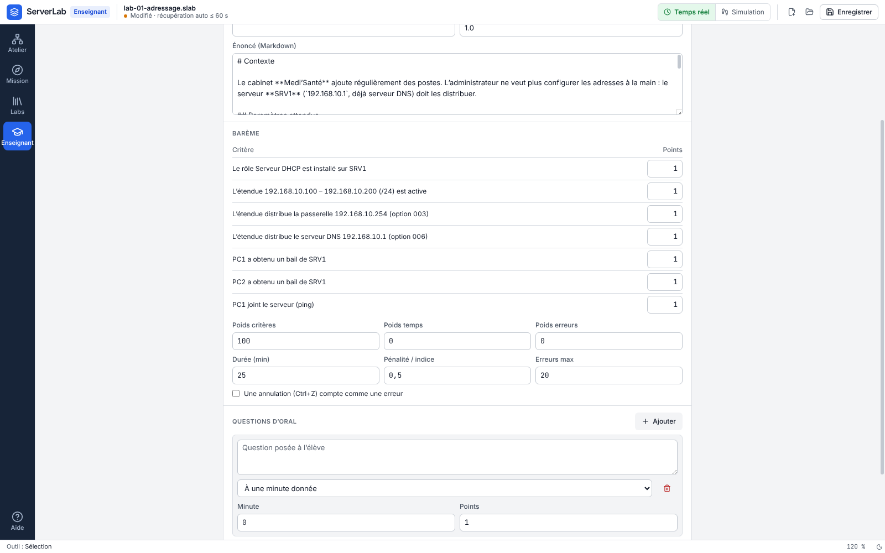
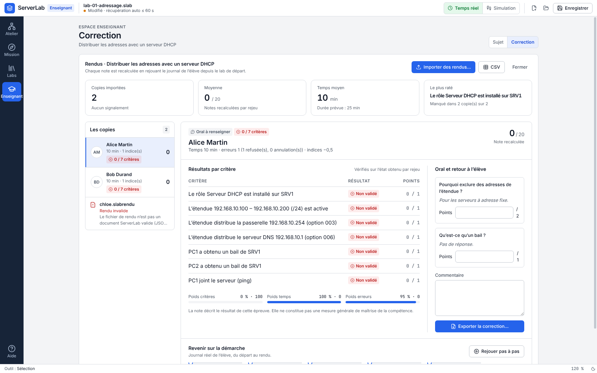
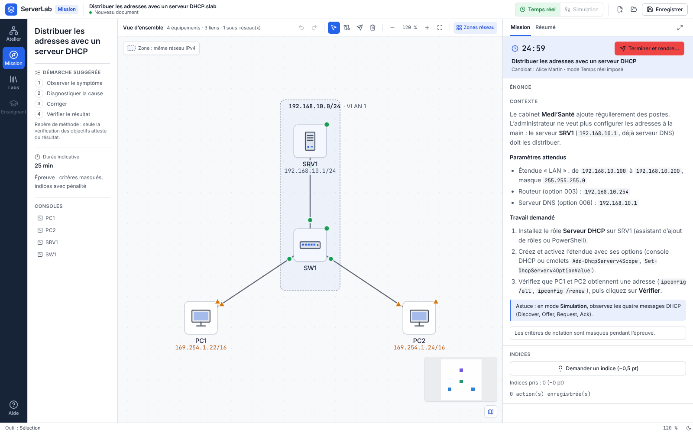

# Mode enseignant (2.12)

Créer un sujet d'évaluation, le faire passer, corriger les rendus et rejouer une copie devant la classe.
Tout fonctionne **hors ligne, par fichiers** : aucun serveur, aucun compte.

Activation : **Affichage > Mode enseignant** (désactivé par défaut). Désactivé, aucun espace, menu ni bouton du
mode enseignant n'est visible. Activé, l'espace **Enseignant** apparaît dans le rail (raccourci `Ctrl+Maj+E`) ;
il recouvre le plan, qui reste intact et inerte, et n'est jamais accessible pendant une épreuve.

| Fichier           | Qui l'écrit | Contenu                                                                                  |
| ----------------- | ----------- | ---------------------------------------------------------------------------------------- |
| `.slabsujet`      | professeur  | lab de départ (topologie, énoncé, critères), barème, questions d'oral, titre, auteur     |
| `.slabrendu`      | élève       | empreinte du sujet, nom de l'élève, journal des actions, indices pris, réponses à l'oral |
| `.slabcorrection` | professeur  | détail par critère, temps, erreurs, pénalités, oral, note, commentaire, signalements     |
| `.csv`            | professeur  | une ligne par élève (séparateur `;`, UTF-8 avec BOM : s'ouvre directement dans Excel)    |

## Guide du professeur

### 1. Créer un sujet

Espace **Enseignant > Sujet**, au choix :

- **Lab de la bibliothèque** : un des 59 labs, puis ajuster l'énoncé et le barème ;
- **À partir du lab ouvert** ;
- **À partir de l'éditeur de labs** : topologie construite à la main (capturée par l'éditeur) et critères choisis
  dans le catalogue, avec leurs formulaires ;
- **Ouvrir un sujet…** pour modifier un `.slabsujet` existant.

Le barème : points par critère, durée, pénalité par indice, nombre d'erreurs au-delà duquel la composante
« erreurs » vaut 0, annulation (Ctrl+Z) comptée ou non comme une erreur, et poids des trois composantes
(critères, temps, erreurs).

Questions d'oral : texte, moment d'affichage (à la minute N ou après la validation d'un critère), points.

**Prévisualisation** : note obtenue par le lab ouvert avec ce barème. Construisez votre solution dans le lab
ouvert : à l'export, si elle n'obtient pas 100 %, un avertissement liste les critères non validés.

### 2. Corriger

Espace **Enseignant > Correction** : choisissez le sujet (celui en cours ou un `.slabsujet`), puis **Importer des
rendus…** (plusieurs fichiers à la fois, 60 au plus). Un fichier refusé reste listé comme « rendu invalide » avec
le message du contrôle.

Chaque note est **recalculée** : le journal de l'élève est rejoué depuis le lab de départ du sujet, puis les
critères sont évalués sur l'état obtenu. La note n'est jamais lue dans le fichier de l'élève.

Pour chaque copie : badges d'état dérivés de la correction (signalée, rejeu interrompu, oral à renseigner,
critères validés), critères ✓ / ✗ avec leurs points, composantes de la note, temps, erreurs, pénalités,
réponses à l'oral (à noter à la main), commentaire libre, chronologie du journal réel de l'élève, puis
**Exporter la correction…**. Pour la classe, seulement ce qui se calcule depuis les copies importées : nombre de
copies, moyenne (sur 20), temps moyen face à la durée prévue, critère le plus raté, signalements, et **CSV**.

### 3. Démonstration

**Rejouer pas à pas** (dans le détail d'une copie) bascule sur l'espace Atelier : la barre du bas permet
d'avancer, reculer, lire à vitesse réglable (×0,5 à ×4). Le plan, l'inspecteur et le panneau Simulation montrent
l'état à chaque pas ; une commande refusée est signalée. **Projection** agrandit toute l'interface pour le
vidéoprojecteur. Fermer la démonstration ramène à l'espace Enseignant.

## Guide de l'élève

1. Activez **Affichage > Mode enseignant**, espace **Enseignant**, **Passer un sujet…**, choisissez le fichier
   donné par le professeur. L'épreuve s'ouvre dans l'espace **Mission**.
2. Saisissez votre nom et choisissez le mode :
   - **Examen** : le rendu est enregistré pour le professeur ;
   - **Auto-évaluation** : même épreuve, puis la note s'affiche tout de suite (pour réviser l'E6 seul).
3. Pendant l'épreuve : chronomètre, énoncé, critères masqués, mode Temps réel imposé. Seuls les espaces Atelier
   et Mission restent accessibles ; ni objectifs du lab, ni Audit, ni Dépannage, ni espace Enseignant.
4. **Indices** : la pénalité est affichée avant de confirmer.
5. **Questions d'oral** : elles s'affichent au moment prévu ; « Plus tard » les referme, la réponse reste
   modifiable jusqu'à la fin.
6. **Terminer et rendre…** (ou temps écoulé) : enregistrez le `.slabrendu` et remettez-le au professeur.
   Ouvrir un autre document pendant l'épreuve la termine (abandon).

## Calcul de la note

| Composante | Valeur (de 0 à 1)                                                             |
| ---------- | ----------------------------------------------------------------------------- |
| Critères   | points des critères validés / points de tous les critères                     |
| Temps      | 1 jusqu'à la moitié de la durée, puis décroît linéairement jusqu'à 0 à la fin |
| Erreurs    | 1 − erreurs / erreurs max (bornée à 0)                                        |

- **Erreur** : commande refusée par le simulateur (adresse invalide, objet inexistant, commande inconnue…), et
  chaque annulation appliquée si le barème le prévoit. Une annulation sans rien à annuler ne compte pas.
- Partie pratique = moyenne pondérée des composantes × points des critères − pénalités d'indices.
- Note = (partie pratique + points de l'oral) / (points des critères + points de l'oral) × note maximale, bornée
  entre 0 et la note maximale.

## Signalements

| Signalement             | Cause                                                                                       |
| ----------------------- | ------------------------------------------------------------------------------------------- |
| Sujet différent         | l'empreinte SHA-256 du sujet dans le rendu ne correspond pas (sujet modifié ou autre sujet) |
| Rejeu interrompu        | une action du journal ne peut pas avoir été produite par l'interface                        |
| Horodatages incohérents | actions hors de la période d'épreuve, dans le désordre, ou liées à un critère absent        |
| Durée hors bornes       | épreuve plus longue que la durée (+ 2 min de tolérance), ou « temps écoulé » trop tôt       |

## Limites (à connaître)

- **Un examen hors ligne n'est pas inviolable.** L'élève dispose du fichier et de l'application sur son poste.
- Le rejeu **détecte les incohérences** (journal fabriqué, note modifiée, sujet changé) : la note ne peut pas être
  falsifiée en modifiant le fichier, mais le rejeu ne prouve pas l'absence de copie, d'aide extérieure ni de
  journal soigneusement reconstruit.
- Les fichiers sont bornés (sujet 4 Mo, rendu 8 Mo et 5 000 pas, correction 1 Mo) et validés strictement : un
  fichier invalide est refusé avec un message, jamais exécuté.

## Données personnelles

- Seule donnée personnelle : **le nom saisi par l'élève**, stocké uniquement dans les fichiers de rendu et de
  correction et dans le CSV.
- **Aucune donnée n'est envoyée sur Internet.** Les fichiers circulent comme l'enseignant le décide (clé USB,
  ENT, dossier partagé).
- Les champs `classId` et `studentId` existent dans les formats pour la version « serveur de l'école » (2.13) ;
  ils restent vides en 2.12.

## Pour les développeurs

Moteur : `src/engine/teacher/` (formats, rejeu, notation, passation) ; interface : `components/teacher/`,
`lib/attempt.ts`, `lib/grading.ts`, `lib/demo.ts` ; fichiers : `src/main/teacherfiles.ts`. Détails des formats et
points d'accroche : [mode-enseignant-integration.md](mode-enseignant-integration.md).
