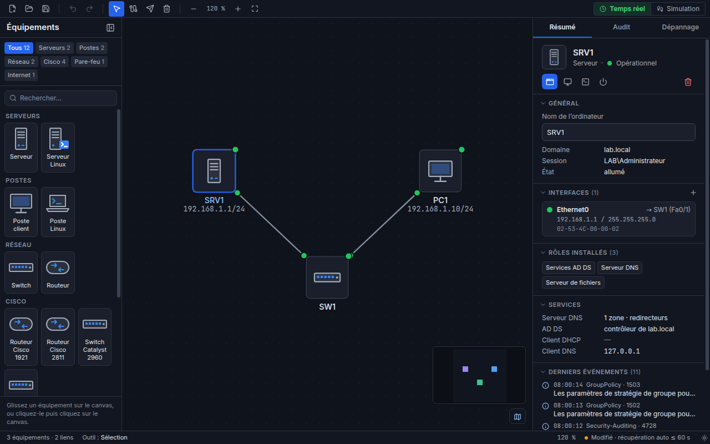
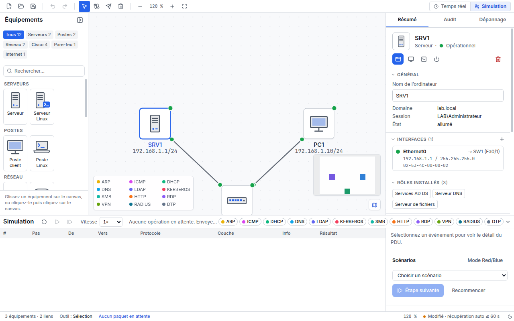

# Interface v2 (2.11.0)

Refonte graphique de l'application en « console d'ingénierie » : sobre, dense, lisible en thème sombre et
clair. Le moteur, le format `.slab` et les migrations ne sont pas modifiés. Le contenu Windows simulé
(`components/desktop`, `components/mmc`, `components/apps`) garde son apparence propre (`data-theme="light"`).

## Principes

- **La forme porte la catégorie, la couleur porte l'état**, toujours doublée d'un second indice (forme du voyant,
  symbole, texte de l'infobulle ou de l'inspecteur) : aucune information n'est donnée par la couleur seule (WCAG 1.4.1).
- **Un seul accent** (bleu) : sélection, outil actif, focus clavier.
- Toutes les couleurs du chrome passent par les tokens `--sl-*` de `src/renderer/src/styles.css`.

## Tokens

| Famille       | Tokens                                                                             | Usage                                      |
| ------------- | ---------------------------------------------------------------------------------- | ------------------------------------------ |
| Fonds         | `app`, `panel`, `surface`, `surface-2`, `surface-3`, `canvas`, `canvas-grid`       | du plus profond au plus élevé              |
| Texte         | `fg`, `fg-muted`, `fg-subtle`                                                      | contraste AA sur tous les fonds            |
| Accent        | `accent` (fond des actions, texte blanc AA), `accent-text`, `accent-soft`, `focus` | sélection, focus                           |
| États         | `ok`, `warn`, `danger`, `info`, `idle`                                             | voyants, pastilles, traits (≥ 3:1)         |
| États (texte) | `ok-text`, `warn-text`, `danger-text`, `info-text`                                 | texte d'état (≥ 4,5:1)                     |
| Icônes        | `icon-accent`                                                                      | détails en accent des icônes d'équipements |
| Protocoles    | `proto-arp` … `proto-dtp`                                                          | enveloppes et pastilles de la simulation   |

Les ratios sont calculés par `node scripts/contrast-tokens.mjs src/renderer/src/styles.css` (tableau dans
[ui-v2-contrastes.md](ui-v2-contrastes.md)).

**Typographie** : Inter (interface) et JetBrains Mono (IP, MAC, ports, consoles) ; échelle stricte
`text-meta` 11 px, `text-dense` 12 px, `text-ui` 13 px (base), `text-title` 15 px. Exceptions : titre de l'écran
d'accueil et notes de score (affichage).

## Disposition

| Zone                     | Composant         | Rôle                                                                               |
| ------------------------ | ----------------- | ---------------------------------------------------------------------------------- |
| Barre d'outils (32 px)   | `MainToolbar`     | fichier, annuler / rétablir, outils, zoom, Temps réel / Simulation                 |
| Palette (gauche)         | `Palette`         | onglets par famille (« Tous » par défaut), vignettes 48 px, recherche, mode replié |
| Canvas                   | `TopologyCanvas`  | grille à points de 20 px, nœuds de 64 px, légende des protocoles en Simulation     |
| Inspecteur (droite)      | `RightPanel`      | Résumé, Lab, Audit, Dépannage                                                      |
| Panneau Simulation (bas) | `SimulationPanel` | lecture, pas, vitesse, filtres, table des événements, détail du PDU, scénarios     |
| Barre d'état             | `StatusBar`       | compteurs, outil actif, zoom, enregistrement, thème                                |

## Équipements et câbles

- Icônes dessinées pour ServerLab (`src/renderer/src/assets/icons/devices.tsx`), deux tons : tour (serveur),
  tour avec invite (serveur Linux), écran (poste), portable (poste Linux), boîtier à ports (switch), boîtier
  arrondi à flèches (routeur), nuage (Internet), mur (pare-feu). Les modèles Cisco portent un bandeau texte « IOS ».
- Voyant d'état (`StatusLed`) : rond plein (opérationnel), triangle (alerte), carré barré (éteint), anneau
  (non raccordé) ; son nom accessible est le libellé de l'état.
- Câbles : voyant de chaque extrémité (rond, triangle, carré barré), infobulle en texte (extrémités, débit,
  état de chaque port). Le débit est déduit des noms de ports (`Fa…` : 100 Mbit/s, sinon 1 Gbit/s).

## Clavier et accessibilité

- Raccourcis et menu natif inchangés (catalogue `src/shared/shortcuts.ts`). Les raccourcis du canvas
  n'agissent jamais depuis une fenêtre d'équipement, un dialogue ou un menu (constat U-01).
- Menu contextuel d'un nœud : clic droit, touche Menu ou Maj+F10 ; flèches, Origine / Fin, Entrée, Échap.
- Boutons à icône seule nommés (`aria-label`), onglets en `tablist`, focus visible (`--sl-focus`).

## Tests

- `tests/e2e/visual.spec.ts` : références visuelles des écrans clés en sombre et clair
  (`npx playwright test visual.spec.ts --update-snapshots` après un changement volontaire).
- `nodes`, `toolbar`, `palette`, `inspector`, `context-menu` : comportements de l'interface v2.
- `performance.spec.ts` : 100 équipements, aucun rendu des autres nœuds pendant un glisser.

